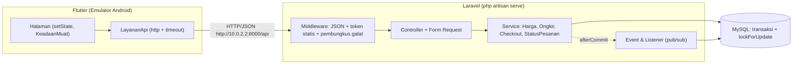
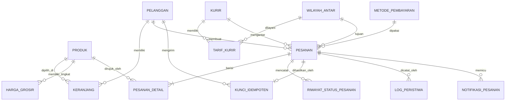

# PRD — Aplikasi Toko Alat Tulis Online (Kelompok 6)

| Butir | Keterangan |
|---|---|
| Nama dokumen | Product Requirements Document (PRD) |
| Proyek | Aplikasi Toko Online — Alur Katalog, Keranjang, dan Checkout |
| Domain | Kelompok 6 — Buku dan Alat Tulis (toko alat tulis) |
| Mata kuliah | Pemrograman Aplikasi Perangkat Bergerak (2010MWP0507) dan Sistem Terdistribusi |
| Tugas | Tugas Pengganti UTS (berkelompok), bobot 20% pada masing-masing mata kuliah |
| Dosen pengampu | Ahsanun Naseh Khudori, S.Kom., M.Kom. |
| Teknologi | REST API Laravel + MySQL (backend), Flutter dengan paket `http` (mobile) |
| Jalur backend | Jalur A — backend sendiri (nilai penuh) |
| Versi / tanggal | 1.0 (draf siap pengembangan) — 4 November 2026 |
| Sumber utama | PDF "Tugas-Pengganti-UTS_PAPB-ST_Toko-Online.pdf" |
| Pengumpulan | Sebelum Pertemuan 8 melalui LMS; penilaian langsung (uji petik) pada Pertemuan 8 |

> Anggota kelompok, NIM, dan peran diisi di bagian 22 dan README (ketentuan PDF Bagian 7).

---

## Daftar Isi

1. Ringkasan Eksekutif
2. Sumber, Konvensi Penandaan, dan Cara Membaca Dokumen
3. Ruang Lingkup dan Batasan Sistem
4. Domain Bisnis Kelompok 6 dan Aturan Bisnis
5. Pengguna dan Cerita Pengguna
6. Kebutuhan Fungsional
7. Kebutuhan Non-Fungsional
8. Arsitektur Sistem
9. Rancangan Basis Data
10. Kontrak API
11. Logika Bisnis di Server
12. Idempotency dan Pencegahan Pesanan Ganda
13. Ketersediaan Produk dan Skenario Pengujiannya
14. Pembatasan Wilayah Pengiriman (Malang)
15. Siklus Status Pesanan
16. Rancangan Aplikasi Flutter
17. Penerapan Konsep Sistem Terdistribusi
18. Rencana Pengujian
19. Keluaran yang Dikumpulkan
20. Pemetaan ke Rubrik Penilaian
21. Persiapan Uji Petik Pertemuan 8
22. Rencana Kerja, Peran, dan Aturan Tim
23. Risiko dan Mitigasi
24. Asumsi dan Hal yang Perlu Dikonfirmasi
- Lampiran A: Data awal (seeder)
- Lampiran B: Contoh bentuk permintaan dan respons
- Lampiran C: Daftar periksa sebelum mengumpulkan

---

## 1. Ringkasan Eksekutif

Kelompok 6 membangun **toko alat tulis online** yang terdiri atas dua bagian: **REST API Laravel di atas MySQL** sebagai satu-satunya sumber kebenaran, dan **aplikasi Flutter** yang hanya menampilkan apa yang dihitung server. Alur aplikasi: katalog → rincian produk → keranjang → checkout → rincian pesanan → riwayat pesanan, ditambah halaman kelola produk (CRUD).

Ciri khas domain (PDF Bagian 3, baris Kelompok 6):

- produk **pre-order** boleh dipesan walau stok nol dan pesanannya berstatus **menunggu stok**;
- **harga grosir** berlaku mulai kuantitas tertentu, sehingga harga menyesuaikan kuantitas.

Persyaratan tambahan dari kelompok yang dipenuhi dokumen ini:

| # | Persyaratan tambahan | Bagian |
|---|---|---|
| T1 | Idempotency checkout: klik berkali-kali, request berulang, retry akibat timeout, tidak menghasilkan pesanan ganda; dijelaskan di Flutter, Laravel, dan database | 12 |
| T2 | Minimal dua produk berstok nol dan/atau tidak tersedia untuk menguji penolakan di keranjang dan checkout, lengkap dengan skenario uji | 13 |
| T3 | Seluruh layanan pengiriman hanya untuk wilayah Malang; pesanan ke luar wilayah ditolak | 14 |
| T4 | Penyesuaian dengan konsep materi kuliah (Kelompok 1–6), dibedakan antara yang diimplementasikan, hanya dijelaskan, dan pengembangan lanjutan | 17 |

Tujuan yang diukur: nilai maksimal pada sembilan kriteria rubrik (Bagian 9 PDF), khususnya Kriteria 4 (kontrak API), 5 (konsistensi data dan transaksi), 6 (penanganan galat), dan 7 (keadaan dan kualitas kode), serta kesiapan setiap anggota pada uji petik.

---

## 2. Sumber, Konvensi Penandaan, dan Cara Membaca Dokumen

PDF dosen adalah sumber utama. Agar jelas mana yang berasal dari dosen dan mana yang keputusan kelompok, setiap ketentuan ditandai:

| Tanda | Arti |
|---|---|
| **[PDF §n]** | Ketentuan tertulis di PDF dosen, Bagian n |
| **[TIM]** | Persyaratan tambahan dari kelompok (T1–T4) |
| **[A-nn]** | Asumsi kelompok untuk hal yang tidak ditentukan PDF (Bagian 24) |
| **[K-nn]** | Hal yang sebaiknya dikonfirmasi ke dosen sebelum dikunci (Bagian 24) |
| **[Opsional]** | Nilai tambah; dikerjakan setelah seluruh butir wajib selesai |

Aturan pembacaan: bila ada pertentangan antara dokumen ini dan PDF, **PDF yang berlaku**. Tidak ada ketentuan baru yang diklaim berasal dari PDF bila tidak tertulis di sana.

Ketidaksesuaian kecil di PDF yang ditemukan saat menyusun dokumen ini ditulis di Bagian 24 (K-06, K-09, K-10, K-12).

---

## 3. Ruang Lingkup dan Batasan Sistem

### 3.1 Dalam ruang lingkup

1. REST API Laravel dengan 14 endpoint wajib **[PDF §4]**.
2. Aplikasi Flutter dengan 7 halaman wajib **[PDF §6]**, memakai `setState`, constructor/callback, dan `Navigator` **[PDF §2, §6]**.
3. Transaksi checkout yang atomik, kunci idempoten, harga disalin ke detail pesanan **[PDF §4, §9 Kriteria 5]**.
4. Penanganan lima jenis galat yang tampil berbeda **[PDF §6]**.
5. Seeder data contoh, README dengan delapan butir yang tercantum pada PDF §7, dokumentasi API (PDF 6–10 halaman), dan video demo ≤ 5 menit **[PDF §7, §9]**.
6. Persyaratan tambahan T1–T4 **[TIM]**.

### 3.2 Batasan sistem (berlaku bagi semua kelompok) **[PDF §1]**

| Batasan | Wujud di proyek kami |
|---|---|
| Pembayaran disimulasikan | Tanpa payment gateway. Pembayaran = perubahan status pesanan (`menunggu_pembayaran` → `menunggu_konfirmasi` → `dibayar`). Dua metode: **tunai di tempat** dan **transfer manual** |
| Pengantaran memakai data internal | Tanpa API ekspedisi. Tabel kurir, wilayah antar, dan tarif ada di MySQL; ongkir dihitung di server |
| Belum ada autentikasi penuh | Identitas pembeli = token statis / `pelanggan_id` tetap (Bagian 8.4). Login JWT/OAuth baru Pertemuan 14 |

### 3.3 Di luar ruang lingkup dan fitur yang tidak wajib

- Payment gateway pihak ketiga, API ekspedisi pihak ketiga, serta login JWT/OAuth **[PDF §1]**.
- Provider/Riverpod/Bloc dan pustaka pengelola keadaan lain: tidak diwajibkan dan tidak menambah nilai pada tugas ini **[PDF §6]**. Gunakan `setState`, constructor, callback, dan `Navigator` sebagai dasar.
- RabbitMQ/Kafka, API Gateway terpisah, gRPC, WebSocket, dan replikasi database **bukan persyaratan wajib dalam PDF tugas ini**. Konsepnya dipetakan pada Bagian 17. Implementasi RabbitMQ hanya menjadi pengembangan tambahan setelah seluruh kebutuhan wajib tugas selesai atau jika dosen secara khusus meminta demonstrasi broker.
- Autentikasi penuh dan manajemen role tidak dikerjakan pada tugas ini; gunakan token statis atau `pelanggan_id` tetap **[PDF §1]**.
- Pengiriman ke luar wilayah Malang **[TIM T3]**.

### 3.4 Jalur backend

Kelompok memilih **Jalur A** (backend Laravel sendiri) agar semua kriteria dapat dinilai penuh **[PDF §5]**. Jalur B (`MockLayananApi`) hanya cadangan darurat dan membatasi Kriteria 4 dan 5 paling tinggi pada skor 2. Rubrik juga menyebut "jalur C" tetapi PDF tidak mendefinisikannya **[K-09]**.

---

## 4. Domain Bisnis Kelompok 6 dan Aturan Bisnis

### 4.1 Domain

Domain Kelompok 6 menurut PDF: **Buku dan alat tulis**. Atribut khas yang wajib: **penanda pre-order** dan **harga grosir mulai kuantitas tertentu**. Aturan wajib pada checkout: *produk pre-order boleh dipesan meski stok nol dan pesanannya berstatus menunggu stok; harga menyesuaikan kuantitas* **[PDF §3]**.

Peringatan PDF: mengganti nama produk saja (misalnya dari nasi goreng menjadi pulpen) tanpa mengubah atribut dan aturan dinilai tidak menyesuaikan domain (Kriteria 1 skor 1). Karena itu atribut dan aturan di bawah ini **harus ditegakkan server**, bukan Flutter (Kriteria 1 skor 4).

### 4.2 Atribut khas domain di produk

| Atribut | Tipe | Keterangan |
|---|---|---|
| `pre_order` | bool | Penanda produk pre-order. Wajib **[PDF §3]** |
| `estimasi_tersedia` | date, nullable | Perkiraan tanggal stok datang untuk produk pre-order **[A-13]** |
| tabel `harga_grosir` | entitas baru | Tingkat harga: `min_kuantitas` dan `harga_satuan`. Tabel yang tidak ada pada domain kelompok lain |

PDF mewajibkan minimal dua kolom khas domain di luar tujuh kolom inti **[PDF §4]**. Kolom `pre_order` dan `estimasi_tersedia` memenuhi syarat itu; tabel `harga_grosir` melengkapi atribut grosir.

### 4.3 Aturan bisnis

| ID | Aturan | Ditegakkan oleh | Kode jika dilanggar |
|---|---|---|---|
| BR-01 | Produk `tersedia=false` tidak dapat dimasukkan ke keranjang maupun dipesan, termasuk bila produk diberi tanda pre-order | Server | 409 |
| BR-02 | Produk non-pre-order dengan stok kurang dari jumlah diminta ditolak; produk pre-order adalah pengecualian hanya jika `tersedia=true` | Server | 409 |
| BR-03 | Produk `pre_order=true` dan `tersedia=true` boleh dipesan walau stok nol atau stok lebih kecil dari jumlah yang diminta; pesanan berstatus `menunggu_stok` sampai stok pre-order tersedia **[PDF §3]** | Server | — (diterima) |
| BR-04 | **Harga satuan mengikuti kuantitas**: dipakai tingkat grosir dengan `min_kuantitas` terbesar yang ≤ jumlah pada baris itu; bila tidak ada, harga normal **[PDF §3, A-14]** | Server | — |
| BR-05 | Pengiriman hanya ke wilayah Malang **[TIM T3]** | Server | 422 |
| BR-06 | Jumlah item harus bilangan bulat > 0 **[PDF §4]** | Server | 422 |
| BR-07 | Harga dan total pesanan disalin ke detail pesanan; perubahan harga produk tidak mengubah pesanan lama **[PDF §9 Kriteria 5]** | Server | — |
| BR-08 | Perpindahan status hanya sesuai urutan sah **[PDF §4]** | Server | 409 |
| BR-09 | Satu percobaan checkout (satu kunci idempoten) menghasilkan paling banyak satu pesanan **[PDF §4, TIM T1]** | Server + DB | — |

---

## 5. Pengguna dan Cerita Pengguna

Karena belum ada autentikasi penuh **[PDF §1]**, hanya ada satu identitas pembeli tetap.

| Peran | Deskripsi | Akses |
|---|---|---|
| Pembeli | Pelanggan tetap (`pelanggan_id` tetap/token statis) yang menelusuri katalog, berbelanja, dan memantau pesanan | Katalog, rincian, keranjang, checkout, rincian dan riwayat pesanan, tombol bayar simulasi |
| Pengelola toko | Mengelola produk dan memproses pesanan | Halaman Kelola produk (CRUD); perubahan status lanjutan (`dibayar` dan seterusnya) lewat PATCH/Postman **[A-10]** |
| Penguji (dosen) | Menjalankan seeder, Postman, aplikasi | Seluruh endpoint dengan token statis di README |

Cerita pengguna utama:

- **US-01** Sebagai pembeli, saya mencari dan menyaring produk sehingga cepat menemukan alat tulis yang dibutuhkan.
- **US-02** Sebagai pembeli, saya melihat produk habis/tidak tersedia ditandai jelas sehingga tidak salah pesan.
- **US-03** Sebagai pembeli, saya memesan produk pre-order walau stok nol dan tahu pesanan saya menunggu stok.
- **US-04** Sebagai pembeli, saya mendapat harga grosir otomatis ketika jumlah beli memenuhi syarat.
- **US-05** Sebagai pembeli, saya melihat subtotal, ongkos kirim, dan total yang dihitung server.
- **US-06** Sebagai pembeli, saya menekan tombol checkout sekali atau berkali-kali, dan hanya satu pesanan terbentuk.
- **US-07** Sebagai pembeli, saya diberi tahu bila alamat saya di luar Malang sehingga pesanan tidak diproses.
- **US-08** Sebagai pembeli, saya mendapat pesan galat yang jelas dan tombol coba lagi ketika jaringan bermasalah.
- **US-09** Sebagai pengelola, saya menambah, mengubah, dan menghapus produk dari aplikasi.
- **US-10** Sebagai penguji, saya menjalankan seeder satu kali dan langsung mencoba semua alur.

---

## 6. Kebutuhan Fungsional

Prioritas: **P1** wajib (PDF), **P2** wajib bagi kelompok (T1–T4/domain), **P3** opsional.

### 6.1 Katalog dan produk (FR-KAT)

| ID | Kebutuhan | Prior. | Sumber |
|---|---|---|---|
| FR-KAT-01 | `GET /api/produk` menampilkan daftar produk; hasil kosong tetap 200 | P1 | PDF §4 |
| FR-KAT-02 | Parameter `?kategori=` dan `?cari=` (cari pada nama) dikerjakan **server**; Flutter mengirim ulang permintaan setiap filter berubah | P1 | PDF §6 |
| FR-KAT-03 | Daftar memakai `ListView.builder` atau `GridView.builder` | P1 | PDF §6 |
| FR-KAT-04 | Produk stok nol/non-pre-order atau `tersedia=false` tampil dengan penanda jelas dan tombol tambah dimatikan; pengecualian hanya produk `pre_order=true` dan `tersedia=true` | P1 | PDF §6, PDF §3 |
| FR-KAT-05 | Produk pre-order tampil dengan penanda "Pre-Order" dan estimasi tersedia; tombol tambah **tetap aktif** walau stok nol | P2 | PDF §3, K-03 |
| FR-KAT-06 | Kartu produk menampilkan petunjuk harga grosir bila ada (dari data server) | P2 | PDF §3 |
| FR-KAT-07 | Ikon keranjang dengan lencana jumlah (nilai dari server) | P1 | PDF §6 |
| FR-KAT-08 | Lazy load/paginasi pada daftar produk | P3 | PDF §6 catatan, K-14 |

### 6.2 Rincian produk (FR-DET)

| ID | Kebutuhan | Prior. | Sumber |
|---|---|---|---|
| FR-DET-01 | `GET /api/produk/{id}`; 404 → keadaan kosong, bukan dialog teknis | P1 | PDF §4, §6 |
| FR-DET-02 | Menampilkan seluruh atribut termasuk `pre_order`, `estimasi_tersedia`, tabel harga grosir; `deskripsi` null ditangani | P1 | PDF §4, §6 |
| FR-DET-03 | Pemilih jumlah dan tombol tambah ke keranjang; setelah berhasil menuju keranjang | P1 | PDF §6 |

### 6.3 Kelola produk / CRUD (FR-CRUD)

| ID | Kebutuhan | Prior. | Sumber |
|---|---|---|---|
| FR-CRUD-01 | `POST /api/produk` → 201; validasi gagal → 422 per kolom | P1 | PDF §4 |
| FR-CRUD-02 | `PUT /api/produk/{id}` → 200; tidak ditemukan → 404 | P1 | PDF §4 |
| FR-CRUD-03 | `DELETE /api/produk/{id}` → 409 bila produk masih terpakai pada pesanan aktif | P1 | PDF §4, A-07 |
| FR-CRUD-04 | Dialog konfirmasi sebelum permintaan hapus dikirim | P1 | PDF §6 |
| FR-CRUD-05 | Daftar produk menyegarkan diri setelah tiap operasi berhasil | P1 | PDF §6 |
| FR-CRUD-06 | Formulir produk memuat tujuh kolom inti dan kolom khas domain (`pre_order`, `estimasi_tersedia`) | P1 | PDF §4 |
| FR-CRUD-07 | Pengelolaan tingkat harga grosir lewat body nested pada POST/PUT (Flutter: opsional) | P2/P3 | A-12 |

### 6.4 Keranjang (FR-KRJ)

| ID | Kebutuhan | Prior. | Sumber |
|---|---|---|---|
| FR-KRJ-01 | Isi keranjang disimpan di **server** sehingga utuh setelah aplikasi ditutup-dibuka | P1 | PDF §6 |
| FR-KRJ-02 | `GET /api/keranjang` mengembalikan item dan **subtotal dari server**; Dart tidak menjumlah ulang | P1 | PDF §4, §6 |
| FR-KRJ-03 | `POST /api/keranjang` menerima `produk_id` dan `jumlah`; produk yang sudah ada **menambah jumlah**, bukan baris kedua | P1 | PDF §4, §6 |
| FR-KRJ-04 | Penambahan yang melebihi stok (non-pre-order) atau produk `tersedia=false` → **409** dengan pesan server; ditampilkan di layar yang terbuka | P1/P2 | PDF §4, T2 |
| FR-KRJ-05 | `PUT /api/keranjang/{id}`: jumlah nol/negatif → 422 | P1 | PDF §4 |
| FR-KRJ-06 | `DELETE /api/keranjang/{id}` → 200 | P1 | PDF §4 |
| FR-KRJ-07 | Harga satuan efektif (grosir) dan subtotal per baris dihitung server | P2 | PDF §3 |
| FR-KRJ-08 | Keranjang kosong tampil sebagai keadaan kosong yang ramah dengan tombol kembali ke katalog | P1 | PDF §6 |
| FR-KRJ-09 | `GET /api/keranjang?kurir_id=&wilayah_id=` opsional menambahkan `ongkos_kirim` dan `total` hitungan server untuk ringkasan checkout | P2 | K-04 |

### 6.5 Checkout dan pembayaran simulasi (FR-CHK)

| ID | Kebutuhan | Prior. | Sumber |
|---|---|---|---|
| FR-CHK-01 | Formulir `Form` dengan validator pada kolom wajib (nama, alamat, kota, wilayah, kurir, metode), pesan Indonesia | P1 | PDF §6 |
| FR-CHK-02 | Kurir dari `GET /api/kurir`; ongkir berubah ketika kurir/wilayah diganti, nilainya dari server | P1 | PDF §6 |
| FR-CHK-03 | Dua metode pembayaran simulasi: `tunai_di_tempat`, `transfer_manual` | P1 | PDF §1, §3 |
| FR-CHK-04 | Tombol checkout dimatikan selama permintaan berjalan | P1 | PDF §6 |
| FR-CHK-05 | `POST /api/checkout` **wajib** membawa header `X-Kunci-Idempoten`, dibuat sekali per percobaan dan dipakai ulang saat coba lagi | P1 | PDF §4, §6 |
| FR-CHK-06 | Berhasil → 201 + nomor pesanan; keranjang dikosongkan **server** tanpa pembersihan dari Flutter | P1 | PDF §6 |
| FR-CHK-07 | Aturan domain (BR-01..BR-04) ditegakkan server; 409/422 membuat layar tetap di checkout | P1 | PDF §3, §6 |
| FR-CHK-08 | Pesanan dengan produk pre-order melebihi stok berstatus `menunggu_stok` | P2 | PDF §3, K-02 |
| FR-CHK-09 | Pengiriman di luar Malang ditolak server (422) | P2 | TIM T3 |
| FR-CHK-10 | Tombol "Bayar" di rincian pesanan memanggil `PATCH /api/pesanan/{id}/status` (bukan perubahan tampilan saja) | P1 | PDF §6 |
| FR-CHK-11 | Idempotency: request berulang dengan kunci sama mengembalikan pesanan yang sama (Bagian 12) | P2 | TIM T1 |

### 6.6 Pesanan (FR-PSN)

| ID | Kebutuhan | Prior. | Sumber |
|---|---|---|---|
| FR-PSN-01 | `GET /api/pesanan` urut terbaru; keadaan kosong bila belum ada | P1 | PDF §4, §6 |
| FR-PSN-02 | `GET /api/pesanan/{id}` memuat item dengan **harga saat pembelian**, total, metode, status | P1 | PDF §4 |
| FR-PSN-03 | `PATCH /api/pesanan/{id}/status` hanya menerima perpindahan sah; selain itu 409 | P1 | PDF §4 |
| FR-PSN-04 | Dari rincian pesanan kembali ke katalog dengan tumpukan halaman dibersihkan | P1 | PDF §6 |
| FR-PSN-05 | Pembatalan hanya dari dua status pertama (dan `menunggu_stok`, K-02) | P1 | PDF §4 |

### 6.7 Penanganan galat dan keadaan layar (FR-ERR)

| ID | Kebutuhan | Prior. | Sumber |
|---|---|---|---|
| FR-ERR-01 | Lima jenis galat (tidak ada sambungan, batas waktu, 422, 409, 500) tampil **berbeda** | P1 | PDF §6 |
| FR-ERR-02 | Setiap pemanggilan punya `.timeout(...)`; timeout menjadi galat terlihat | P1 | PDF §6 |
| FR-ERR-03 | Galat 422 tampil per kolom di bawah kolom, bukan dialog umum | P1 | PDF §6 |
| FR-ERR-04 | Galat 500 menampilkan pesan umum + coba lagi, tanpa jejak galat | P1 | PDF §6 |
| FR-ERR-05 | Larangan: `e.toString()` ke pengguna, blok `catch` kosong, satu pesan untuk kelima jenis | P1 | PDF §6 |
| FR-ERR-06 | Setiap halaman pemanggil API memakai `enum KeadaanMuat { memuat, berhasil, kosong, galat }`; kosong ≠ galat | P1 | PDF §6 |
| FR-ERR-07 | Tombol coba lagi di semua halaman pemanggil API | P1 | PDF §9 Kriteria 6 |

---

## 7. Kebutuhan Non-Fungsional

| ID | Kebutuhan | Cara memenuhi |
|---|---|---|
| NFR-01 | **Server sebagai sumber kebenaran**: harga, subtotal, ongkir, total, ketersediaan dihitung Laravel | Flutter hanya membaca dan menampilkan **[PDF §4]** |
| NFR-02 | **Atomik**: pengurangan stok, penyimpanan pesanan, pengosongan keranjang dalam satu transaksi | `DB::transaction` + `lockForUpdate` **[PDF §4]** |
| NFR-03 | **Konsistensi saat paralel**: dua pembeli memesan unit terakhir → tepat satu berhasil | Kunci baris produk (Bagian 12.3, 18) |
| NFR-04 | **Respons seragam** | Satu pembungkus `status/code/message/data/errors` untuk semua endpoint, termasuk 404 rute dan 500 |
| NFR-05 | **Tahan gangguan jaringan** | Timeout, coba lagi dengan kunci sama, tidak ada data setengah jadi |
| NFR-06 | **Tidak membocorkan detail teknis** | Handler pengecualian Laravel mengubah galat menjadi pesan umum; tanpa HTML/SQL mentah **[PDF §4]** |
| NFR-07 | **Mudah diuji penguji** | `php artisan migrate --seed` sekali jalan; token statis di README; koleksi Postman |
| NFR-08 | **Kode bersih** | Satu kelas `LayananApi`, tanpa pemanggilan jaringan di `build`, tanpa `print` sisa dan kode mati **[PDF §6, §11]** |
| NFR-09 | **Keamanan dasar** | `.env` tidak diunggah, hanya `.env.example`; validasi input; parameter query terikat (Eloquent) |
| NFR-10 | **Mata uang** | Rupiah bulat `int`, tanpa desimal dan pemisah ribuan pada JSON **[PDF §4]** |
| NFR-11 | **Waktu** | Zona waktu `Asia/Jakarta`; seluruh cap waktu dibuat server **[A-02]** |
| NFR-12 | **Kompatibilitas lanjutan** | Pengiriman token di satu tempat pada `LayananApi` agar penggantian login Pertemuan 14 cukup satu berkas **[PDF §11]** |

---

## 8. Arsitektur Sistem

### 8.1 Gambaran



### 8.2 Pembagian tanggung jawab **[PDF §4]**

| Lapisan | Tanggung jawab | Dilarang |
|---|---|---|
| MySQL | Menyimpan produk, harga grosir, keranjang, pesanan, detail pesanan, kurir, wilayah, tarif, kunci idempoten | Menyimpan total sebagai satu-satunya sumber tanpa detail per item |
| Laravel | Validasi, subtotal, harga grosir, ongkir, pengurangan stok, perpindahan status, penegakan aturan domain dan wilayah | Mengembalikan HTML atau pesan galat mentah basis data |
| Flutter | Menampilkan data, mengirim permintaan, mengelola keadaan layar, menampilkan galat | Menghitung total, memutuskan ketersediaan, menyimpan harga hasil hitung sendiri |

### 8.3 Struktur proyek

```
nama-repositori/
|-- backend/                      # Laravel
|   |-- app/Http/Controllers/     # ProdukController, KeranjangController, KurirController, CheckoutController, PesananController
|   |-- app/Http/Middleware/      # PastikanJson, TokenStatis
|   |-- app/Http/Requests/        # validasi per endpoint
|   |-- app/Services/             # HargaService, OngkirService, CheckoutService, StatusPesananService
|   |-- app/Events/ + Listeners/  # PesananDibuat, StatusPesananBerubah
|   |-- app/Support/ApiResponse.php
|   |-- database/migrations/
|   |-- database/seeders/         # wajib memuat data contoh Bagian 3
|   `-- .env.example              # tanpa kata sandi sebenarnya
|-- mobile/
|   `-- lib/
|       |-- config/api_config.dart        # satu konstanta alamat server
|       |-- services/layanan_api.dart     # semua pemanggilan API
|       |-- models/                       # produk, item_keranjang, pesanan, kurir, galat
|       |-- screens/                      # 7 halaman + formulir produk
|       |-- widgets/                      # kartu produk, keadaan kosong, keadaan galat
|       `-- main.dart
`-- README.md
```

### 8.4 Identitas pembeli **[PDF §1]**

- Middleware `TokenStatis` membaca header `Authorization: Bearer <token-statis>` dan menetapkan `pelanggan_id = 1` **[A-01]**.
- Nilai token ada di `.env` (`TOKEN_STATIS_PEMBELI`); contoh nilai non-rahasia di `.env.example` dan README (butir 6 README).
- Flutter menaruh token di **satu tempat** pada `LayananApi` (header bawaan), sehingga Pertemuan 14 cukup mengganti satu berkas **[PDF §11]**.

### 8.5 Alamat server **[PDF §6]**

- Emulator Android: `http://10.0.2.2:8000/api`, karena `localhost` di emulator merujuk pada emulator itu sendiri.
- Disimpan dalam satu konstanta `ApiConfig.baseUrl`; alasan ditulis di README (butir 5).
- Server dijalankan dengan `php artisan serve --host=0.0.0.0 --port=8000` bila diuji dari perangkat fisik **[A-11]**.

---

## 9. Rancangan Basis Data

### 9.1 Diagram relasi



### 9.2 Definisi tabel

Konvensi: kolom waktu memakai `created_at`/`updated_at` bawaan Laravel; uang `unsigned integer` (Rupiah).

**`pelanggan`** — identitas tetap pengganti login.

| Kolom | Tipe | Catatan |
|---|---|---|
| id | bigint PK | Seeder: `id = 1` |
| nama | varchar(100) | |

**`produk`** — tujuh kolom inti wajib + kolom khas domain **[PDF §4]**.

| Kolom | Tipe | Catatan |
|---|---|---|
| id | bigint PK | |
| nama | varchar(150) | wajib |
| harga | unsigned int | Rupiah bulat; harga normal satuan |
| kategori | varchar(60), index | salah satu kategori terdaftar (Bagian Lampiran A) |
| stok | unsigned int | 0 = tidak dapat dipesan (kecuali pre-order) |
| tersedia | boolean, default true | penanda aktif, **terpisah dari stok** |
| deskripsi | text **nullable** | Flutter wajib menangani null |
| `pre_order` | boolean, default false | **khas domain** |
| `estimasi_tersedia` | date nullable | **khas domain**; hanya bermakna bila `pre_order` |

**`harga_grosir`** — **tabel khas domain**.

| Kolom | Tipe | Catatan |
|---|---|---|
| id | bigint PK | |
| produk_id | FK → produk, cascade on delete | |
| min_kuantitas | unsigned int | ≥ 2 |
| harga_satuan | unsigned int | harus < `produk.harga` (validasi) |
| | | **unique (produk_id, min_kuantitas)** |

**`keranjang`**

| Kolom | Tipe | Catatan |
|---|---|---|
| id | bigint PK | |
| pelanggan_id | FK → pelanggan | |
| produk_id | FK → produk, cascade on delete | **[A-09]** |
| jumlah | unsigned int | > 0 |
| | | **unique (pelanggan_id, produk_id)** — menjamin penambahan produk yang sama tidak membuat baris kedua |

**`kurir`**, **`wilayah_antar`**, **`tarif_kurir`** — pengantaran internal **[PDF §1]**, dibatasi Malang **[TIM T3]**.

| Tabel | Kolom |
|---|---|
| `kurir` | id, nama, deskripsi (nullable), aktif (bool) |
| `wilayah_antar` | id, nama (kecamatan), kota (`Kota Malang`), aktif (bool) |
| `tarif_kurir` | id, kurir_id FK, wilayah_id FK, tarif unsigned int; **unique (kurir_id, wilayah_id)** |

**`metode_pembayaran`** — id, kode (`tunai_di_tempat`, `transfer_manual`; unique), nama. Dua baris sesuai PDF §3.

**`pesanan`**

| Kolom | Tipe | Catatan |
|---|---|---|
| id | bigint PK | |
| nomor_pesanan | varchar(30) **unique** | dibuat server **[A-03]** |
| pelanggan_id | FK | |
| nama_penerima, alamat, kota | varchar/text | `kota` divalidasi (Bagian 14) |
| wilayah_id, kurir_id, metode_pembayaran_id | FK | |
| subtotal, ongkos_kirim, total | unsigned int | **hasil hitung server**, tetap ada rinciannya di `pesanan_detail` |
| status | varchar(30), index | nilai pada Bagian 15 |
| | | index (pelanggan_id, created_at) untuk riwayat |

**`pesanan_detail`** — salinan harga saat pembelian (BR-07).

| Kolom | Tipe | Catatan |
|---|---|---|
| id | bigint PK | |
| pesanan_id | FK, cascade on delete | |
| produk_id | FK **nullable**, null on delete | produk boleh dihapus, riwayat tetap utuh **[A-09]** |
| nama_produk | varchar | salinan |
| harga_normal | unsigned int | salinan harga normal saat itu |
| harga_satuan | unsigned int | salinan harga efektif (setelah grosir) |
| jumlah | unsigned int | |
| subtotal | unsigned int | `harga_satuan × jumlah` |
| menunggu_stok | boolean | true bila baris pre-order melebihi stok |
| stok_dikurangi | unsigned int | jumlah stok yang benar-benar dikurangi; dipakai saat pembatalan **[A-14, K-11]** |

**`riwayat_status_pesanan`** — id, pesanan_id FK, status_lama (nullable), status_baru, created_at. Menjaga urutan kejadian (Bagian 17, konsep Kelompok 4).

**`kunci_idempoten`** — tulang punggung T1.

| Kolom | Tipe | Catatan |
|---|---|---|
| id | bigint PK | |
| pelanggan_id | FK | |
| kunci | varchar(64) | nilai header `X-Kunci-Idempoten` |
| hash_permintaan | char(64) | SHA-256 dari isi permintaan yang dinormalisasi |
| pesanan_id | FK **nullable** → pesanan | terisi dalam transaksi yang sama |
| created_at | timestamp | |
| | | **unique (pelanggan_id, kunci)** |

**`log_peristiwa`** dan **`notifikasi_pesanan`** — pelanggan (subscriber) event, Bagian 17.

| Tabel | Kolom |
|---|---|
| `log_peristiwa` | id, kunci_peristiwa **unique** (mis. `pesanan_dibuat:{id}`), nama_peristiwa, pesanan_id (nullable), payload (json), created_at |
| `notifikasi_pesanan` | id, pesanan_id FK, kunci_peristiwa **unique**, pesan, dibaca (bool), created_at |

Tabel `log_peristiwa` dan `notifikasi_pesanan` bukan kebutuhan inti pada PDF. Pertahankan hanya jika kelompok benar-benar membuat fitur audit/notifikasi. Demikian juga, migrasi `jobs` dan `failed_jobs` hanya diperlukan bila antrean Laravel database digunakan. Jangan menambahkan tabel atau queue yang tidak dipakai oleh kode karena akan membuat desain dan implementasi tidak konsisten.

Migrasi bawaan Laravel `jobs` dan `failed_jobs` dipakai bila antrean `database` diaktifkan.

### 9.3 Integritas dan indeks (ringkas)

- Semua FK memakai InnoDB dengan aturan hapus yang eksplisit (lihat tabel).
- `produk` dihapus: `keranjang` dan `harga_grosir` ikut terhapus; `pesanan_detail.produk_id` menjadi null tetapi `nama_produk` dan harga tetap.
- Penghapusan produk ditolak dengan 409 bila masih ada `pesanan_detail` pada pesanan aktif (status bukan `selesai`/`dibatalkan`) **[A-07]**.
- Seeder minimal: Lampiran A (≥ 12 produk dalam ≥ 2 kategori; ≥ 2 produk stok nol dan/atau tidak tersedia untuk uji penolakan; ≥ 3 pilihan kurir atau wilayah antar internal dengan tarif berbeda; 2 metode pembayaran; ≥ 3 pesanan contoh dengan status berbeda) **[PDF §3]**.

---

## 10. Kontrak API

Seluruh endpoint wajib dari PDF §4 harus tersedia. Nama jalur di bawah mengikuti PDF dan harus sama pada Laravel, Flutter, Postman, serta dokumentasi API.

### 10.1 Konvensi umum

- Prefix: `/api`.
- Format request dan response: JSON.
- Header umum: `Accept: application/json`, `Content-Type: application/json`.
- Header identitas pembeli: `Authorization: Bearer <token-statis>` sesuai middleware yang disepakati kelompok.
- Header khusus checkout: `X-Kunci-Idempoten: <UUID>`.
- Semua nilai uang berupa integer Rupiah tanpa tanda pemisah ribuan.
- Semua response memakai pembungkus seragam `status`, `code`, `message`, dan `data`; response validasi menambahkan `errors`.
- HTTP status harus benar-benar dikirim sebagai status HTTP, bukan hanya ditulis di properti `code`.

Contoh response sukses:

```json
{
  "status": "sukses",
  "code": "200",
  "message": "Data berhasil diambil",
  "data": {}
}
```

Contoh response validasi:

```json
{
  "status": "gagal",
  "code": "422",
  "message": "Data yang dikirim belum valid",
  "errors": {
    "jumlah": ["Jumlah harus lebih besar dari nol."]
  }
}
```

### 10.2 Daftar 14 endpoint wajib

| No. | Method dan endpoint | Request/parameter utama | Response berhasil | Status gagal yang relevan |
|---:|---|---|---|---|
| 1 | `GET /api/produk` | Query `kategori`, `cari` | `200`, daftar produk; hasil kosong tetap array kosong | `500` |
| 2 | `GET /api/produk/{id}` | ID produk | `200`, detail produk | `404`, `500` |
| 3 | `POST /api/produk` | JSON produk, termasuk atribut domain dan aturan grosir | `201`, produk dibuat | `422`, `500` |
| 4 | `PUT /api/produk/{id}` | ID dan JSON perubahan produk | `200`, produk diperbarui | `404`, `422`, `500` |
| 5 | `DELETE /api/produk/{id}` | ID produk | `200`, konfirmasi penghapusan | `404`, `409`, `500` |
| 6 | `GET /api/keranjang` | Identitas pelanggan dari token | `200`, item, harga efektif, subtotal server | `500` |
| 7 | `POST /api/keranjang` | `produk_id`, `jumlah` | `200` atau `201` sesuai kontrak yang dipilih dan didokumentasikan | `404`, `409`, `422`, `500` |
| 8 | `PUT /api/keranjang/{id}` | `jumlah` baru | `200`, item dan subtotal terbaru | `404`, `409`, `422`, `500` |
| 9 | `DELETE /api/keranjang/{id}` | ID item keranjang | `200`, pesan berhasil | `404`, `500` |
| 10 | `GET /api/kurir` | Opsional query wilayah | `200`, pilihan kurir/wilayah dan tarif | `500` |
| 11 | `POST /api/checkout` | Data penerima, `wilayah_id`, `kurir_id`, metode pembayaran; header idempotency wajib | `201`, nomor pesanan dan ringkasan | `404`, `409`, `422`, `500` |
| 12 | `GET /api/pesanan` | Identitas pelanggan dari token | `200`, riwayat terbaru lebih dahulu | `500` |
| 13 | `GET /api/pesanan/{id}` | ID pesanan milik pelanggan | `200`, detail dan snapshot harga | `404`, `500` |
| 14 | `PATCH /api/pesanan/{id}/status` | `status` tujuan | `200`, status baru | `404`, `409`, `422`, `500` |

Catatan:
- PDF menetapkan 14 endpoint tersebut. Endpoint tambahan seperti kategori, notifikasi, atau konfirmasi pembayaran boleh dibuat, tetapi bukan pengganti endpoint wajib.
- Untuk `POST /api/keranjang`, tetapkan satu kode sukses secara konsisten. Rekomendasi: `200` saat item yang sudah ada ditambah jumlahnya dan `201` saat baris keranjang baru dibuat. Dokumentasikan perilaku aktual.
- `DELETE /api/keranjang/{id}` menggunakan `200` karena itulah kontrak yang tercantum dalam PDF, meskipun API lain dapat memilih `204`.
- Jangan mengembalikan HTML Laravel, halaman debug, SQL mentah, atau stack trace kepada Flutter.

### 10.3 Kontrak produk

Objek produk minimal harus selalu menyediakan tujuh kunci inti dari PDF, ditambah atribut khas domain:

```json
{
  "id": 1,
  "nama": "Pulpen Gel Hitam",
  "harga": 5000,
  "kategori": "Alat Tulis",
  "stok": 20,
  "tersedia": true,
  "deskripsi": "Pulpen tinta gel 0,5 mm",
  "pre_order": false,
  "estimasi_tersedia": null,
  "harga_grosir": [
    {
      "min_kuantitas": 10,
      "harga_satuan": 4500
    },
    {
      "min_kuantitas": 50,
      "harga_satuan": 4000
    }
  ]
}
```

Flutter wajib menangani `deskripsi` dan `estimasi_tersedia` yang bernilai `null`.

### 10.4 Kontrak keranjang

Request:

```json
{
  "produk_id": 1,
  "jumlah": 3
}
```

Contoh response:

```json
{
  "status": "sukses",
  "code": "200",
  "message": "Keranjang berhasil diperbarui",
  "data": {
    "items": [
      {
        "id": 12,
        "produk_id": 1,
        "nama": "Pulpen Gel Hitam",
        "jumlah": 3,
        "harga_satuan": 5000,
        "subtotal": 15000
      }
    ],
    "subtotal": 15000
  }
}
```

Nilai `harga_satuan` dan `subtotal` berasal dari Laravel. Flutter hanya menampilkannya.

### 10.5 Kontrak checkout

Request body contoh:

```json
{
  "nama_penerima": "Pelanggan Demo",
  "alamat": "Jl. Contoh No. 10",
  "kota": "Kota Malang",
  "wilayah_id": 1,
  "kurir_id": 1,
  "metode_pembayaran": "transfer_manual"
}
```

Header wajib:

```http
X-Kunci-Idempoten: 7c9e6679-7425-40de-944b-e07fc1f90ae7
```

Contoh response berhasil:

```json
{
  "status": "sukses",
  "code": "201",
  "message": "Pesanan berhasil dibuat",
  "data": {
    "pesanan_id": 101,
    "nomor_pesanan": "ATK-20261104-00101",
    "status": "menunggu_pembayaran",
    "subtotal": 15000,
    "ongkos_kirim": 7000,
    "total": 22000
  }
}
```

Angka di atas hanya contoh bentuk response, bukan tarif atau nomor pesanan yang harus dipakai. Contoh request/response dalam PDF dokumentasi akhir harus diganti dengan hasil pemanggilan nyata dari server kelompok.

---

## 11. Logika Bisnis di Server

### 11.1 Perhitungan harga grosir

Untuk setiap baris produk:
1. Ambil harga normal dari database.
2. Ambil aturan harga grosir produk tersebut.
3. Pilih aturan dengan `min_kuantitas` tertinggi yang nilainya tidak melebihi jumlah pembelian.
4. Jika tidak ada aturan yang cocok, gunakan harga normal.
5. Hitung subtotal baris = harga satuan efektif × jumlah.
6. Simpan harga normal, harga efektif, jumlah, dan subtotal sebagai snapshot di `pesanan_detail`.

Contoh ilustratif:

| Jumlah beli | Harga satuan |
|---:|---:|
| 1–9 | Rp5.000 |
| 10–49 | Rp4.500 |
| ≥50 | Rp4.000 |

Contoh: pembeli mengambil 12 unit. Server menggunakan Rp4.500 per unit, sehingga subtotal baris Rp54.000. Nilai tersebut tidak dihitung ulang oleh Flutter.

### 11.2 Perhitungan ongkos kirim

1. Flutter meminta daftar pilihan dari `GET /api/kurir`.
2. Pengguna memilih wilayah dan kurir yang aktif.
3. Laravel memeriksa bahwa `wilayah_id` benar-benar terdaftar, aktif, dan berada di wilayah layanan Malang.
4. Laravel mengambil tarif berdasarkan pasangan `kurir_id` dan `wilayah_id`.
5. Total = subtotal semua baris + ongkos kirim.
6. Flutter menampilkan angka dari server.

Tarif adalah data konfigurasi toko, bukan angka yang ditanam permanen di aplikasi Flutter.

### 11.3 Checkout atomik

Urutan proses yang direkomendasikan:

1. Laravel menerima checkout dan membaca `X-Kunci-Idempoten`.
2. Laravel memvalidasi identitas pelanggan dan payload.
3. Laravel memeriksa apakah key pernah dipakai oleh pelanggan tersebut.
4. Jika key sudah ada dan payload hash sama, Laravel mengembalikan pesanan lama.
5. Jika key sudah ada tetapi payload hash berbeda, Laravel mengembalikan `409 Conflict`.
6. Jika key baru, Laravel memulai transaksi database.
7. Kunci baris keranjang dan baris produk terkait menggunakan `lockForUpdate()`; urutkan penguncian produk berdasarkan ID untuk mengurangi risiko deadlock.
8. Validasi ulang status tersedia, stok, dan aturan preorder.
9. Hitung harga grosir, subtotal, ongkir, dan total di server.
10. Buat pesanan dan detail pesanan.
11. Kurangi stok hanya untuk kuantitas yang benar-benar tersedia dan direservasi. Jangan mengurangi stok negatif.
12. Simpan catatan `stok_dikurangi` pada setiap detail untuk keperluan pembatalan atau pemulihan stok.
13. Simpan key idempotency, hash payload, dan relasi ke pesanan.
14. Kosongkan keranjang pelanggan.
15. Commit transaksi.
16. Baru setelah commit, kirim response `201`.

Jika langkah sebelum commit gagal, transaksi di-rollback sehingga stok, pesanan, keranjang, dan catatan idempotency tidak tertinggal dalam keadaan setengah jadi.

### 11.4 Perlindungan pembelian stok terakhir

Jika stok produk adalah 1 dan dua checkout berbeda meminta produk tersebut hampir bersamaan:
- Request pertama mengunci baris produk.
- Request kedua menunggu kunci dilepas.
- Request pertama memvalidasi, membuat pesanan, mengurangi stok menjadi 0, lalu commit.
- Request kedua membaca stok terbaru dan ditolak dengan `409`.
- Hasil akhirnya hanya satu pesanan yang berhasil membeli unit terakhir.

### 11.5 Preorder dan stok campuran

Aturan domain Kelompok 6 harus tetap terlihat pada checkout:
- Produk `pre_order=true` dan `tersedia=true` boleh dipesan walaupun stok 0.
- Produk `tersedia=false` tetap ditolak, walaupun memiliki penanda preorder.
- Untuk item preorder yang belum tersedia, jumlah tersebut tidak boleh mengurangi stok negatif.
- Jika satu pesanan memuat item reguler dan preorder yang belum tersedia, status pesanan keseluruhan menjadi `menunggu_stok`.
- Stok item reguler yang sudah direservasi dicatat pada `stok_dikurangi` dan dipulihkan bila pesanan dibatalkan.
- Setelah stok preorder tiba dan seluruh item siap, pesanan dapat berpindah ke `menunggu_pembayaran`.

Aturan pesanan campuran ini adalah keputusan desain kelompok [A-14], bukan aturan yang dijelaskan secara rinci dalam PDF. Jika ingin menyederhanakan implementasi, kelompok dapat membatasi satu checkout agar tidak mencampur item preorder dan non-preorder, tetapi pembatasan tersebut harus ditampilkan jelas di UI dan disetujui dosen.

---

## 12. Idempotency dan Pencegahan Pesanan Ganda

### 12.1 Tujuan

Idempotency memastikan satu percobaan checkout hanya menghasilkan paling banyak satu pesanan walaupun:
- Tombol checkout ditekan beberapa kali.
- Flutter mengirim ulang request karena timeout.
- Server sudah menyimpan pesanan, tetapi response tidak sampai ke perangkat.
- Pengguna menekan tombol coba lagi.
- Dua request dengan key sama tiba hampir bersamaan.

Menonaktifkan tombol saat request berlangsung adalah perlindungan UX, bukan perlindungan utama. Perlindungan utama berada di Laravel dan MySQL.

### 12.2 Aturan key

- Flutter membuat satu UUID acak untuk setiap percobaan checkout baru.
- Key dikirim melalui header `X-Kunci-Idempoten`.
- Jika terjadi timeout atau koneksi terputus dan hasil checkout belum diketahui, Flutter menyimpan dan menggunakan kembali key yang sama.
- Setelah server memastikan checkout berhasil dan nomor pesanan diterima, key untuk percobaan itu tidak digunakan lagi.
- Jika pengguna mengubah isi checkout dan memulai transaksi baru, Flutter membuat key baru.
- Key memiliki cakupan per pelanggan, dengan unique constraint `(pelanggan_id, kunci)`.

### 12.3 Pemeriksaan server

Laravel menghitung SHA-256 dari payload checkout yang telah dinormalisasi, lalu membandingkannya dengan `hash_permintaan` yang tersimpan.

| Kondisi | Perilaku server |
|---|---|
| Key belum pernah digunakan | Jalankan checkout normal |
| Key sama, payload sama, pesanan sudah tersimpan | Kembalikan pesanan yang sama; jangan membuat pesanan baru |
| Key sama, payload berbeda | `409 Conflict`; jangan jalankan checkout |
| Request pertama belum selesai | Request kedua tidak boleh membuat pesanan lain; tunggu hasil transaksi pertama atau balas konflik sementara yang dapat dicoba ulang dengan key sama |
| Transaksi pertama rollback | Tidak ada pesanan atau key sukses yang tertinggal; retry dengan key sama dan payload sama boleh diproses |

### 12.4 Jaminan database

- Unique constraint pada `(pelanggan_id, kunci)`.
- Pembuatan key dan pesanan dilakukan dalam transaksi yang sama.
- `pesanan_id` pada tabel `kunci_idempoten` diisi sebelum transaksi commit.
- Jika terjadi duplicate-key akibat dua request bersamaan, Laravel menangani exception tersebut dengan membaca record key yang sudah dibuat dan mengembalikan pesanan terkait.
- Jangan mengandalkan pemeriksaan `SELECT` saja tanpa unique constraint, karena dua request dapat sama-sama lolos pemeriksaan pada waktu bersamaan.

### 12.5 Skenario uji wajib

1. Tekan checkout sekali: satu pesanan dibuat.
2. Kirim ulang request dengan key dan payload sama: pesanan yang sama dikembalikan.
3. Kirim request yang sama dua kali secara hampir bersamaan: hanya satu pesanan terbentuk.
4. Gunakan key sama dengan payload berbeda: server membalas 409.
5. Simulasikan response hilang setelah commit: retry dengan key sama mengembalikan pesanan yang sudah dibuat.
6. Simulasikan kegagalan sebelum commit: tidak ada pesanan, stok, atau pengosongan keranjang yang tertinggal.

---

## 13. Ketersediaan Produk dan Skenario Pengujiannya

### 13.1 Data minimal yang harus tersedia

PDF mensyaratkan minimal dua produk berstok nol atau bertanda tidak tersedia untuk menguji penolakan di keranjang. Seeder kelompok sebaiknya membuat tiga kondisi berikut agar aturan domain tidak tertukar:

| Kode | Nama contoh | Stok | Tersedia | Preorder | Hasil |
|---|---|---:|---|---|---|
| P-01 | Pena Gel Premium | 0 | Ya | Tidak | Ditolak |
| P-02 | Buku Catatan Edisi Lama | 5 | Tidak | Tidak | Ditolak |
| P-03 | Paket Buku Persiapan | 0 | Ya | Ya | Diterima sebagai preorder, status `menunggu_stok` |

P-01 dan P-02 memenuhi kebutuhan minimal dua produk yang harus ditolak. P-03 membuktikan pengecualian preorder khas Kelompok 6.

### 13.2 Aturan keputusan

| `tersedia` | `pre_order` | Stok mencukupi | Keputusan |
|---|---|---|---|
| false | false | Ya/Tidak | Tolak |
| false | true | Ya/Tidak | Tolak |
| true | false | Ya | Terima |
| true | false | Tidak | Tolak |
| true | true | Ya | Terima; gunakan stok tersedia |
| true | true | Tidak/0 | Terima sebagai preorder; jangan kurangi stok yang tidak ada |

### 13.3 Acceptance test

| ID | Langkah | Hasil yang diharapkan |
|---|---|---|
| STK-01 | Buka detail P-01 | Label stok habis; tombol tambah nonaktif |
| STK-02 | Kirim POST keranjang untuk P-01 melalui Postman | Server menolak dengan 409 |
| STK-03 | Kirim POST keranjang untuk P-02 | Server menolak dengan 409 walaupun stok masih ada |
| STK-04 | Tambahkan P-03 ke keranjang | Diterima karena preorder aktif |
| STK-05 | Checkout P-03 | Pesanan berstatus `menunggu_stok`; stok tidak menjadi negatif |
| STK-06 | Ubah stok setelah item berada di keranjang menjadi tidak cukup | Checkout memvalidasi ulang dan menolak item non-preorder dengan 409 |
| STK-07 | Dua pembeli memesan stok terakhir secara bersamaan | Hanya satu checkout berhasil |

Validasi Flutter berguna untuk pengalaman pengguna, tetapi seluruh aturan di atas wajib ditegakkan ulang oleh Laravel.

---

## 14. Pembatasan Wilayah Pengiriman (Malang)

### 14.1 Cakupan awal

Untuk menghindari tafsir wilayah yang berbeda, rancangan awal menggunakan **Kota Malang saja**. Kabupaten Malang dan Kota Batu tidak otomatis termasuk layanan. Jika kelompok bermaksud memakai Malang Raya, cakupan harus dikonfirmasi dan daftar wilayah diubah sebelum implementasi.

### 14.2 Aturan

- Daftar pilihan pengiriman berasal dari `GET /api/kurir`.
- Data wilayah dan tarif disimpan di MySQL.
- Contoh zona uji: Lowokwaru, Klojen, dan Blimbing. Zona final harus disesuaikan dengan keputusan kelompok.
- Tarif dapat berbeda antarwilayah dan/atau kurir.
- Laravel hanya menerima `wilayah_id` aktif yang terdaftar sebagai bagian dari Kota Malang.
- Laravel tidak boleh hanya mempercayai teks `kota` yang dikirim Flutter; validasi harus berdasarkan relasi wilayah di database.
- Alamat di luar wilayah layanan ditolak dengan `422` dan pesan yang jelas.
- Flutter tidak boleh menampilkan pilihan pengiriman ke luar wilayah layanan.

### 14.3 Skenario uji

| ID | Data | Hasil |
|---|---|---|
| MAL-01 | Wilayah aktif di Kota Malang | Dapat dipilih |
| MAL-02 | Wilayah tidak aktif | Ditolak server |
| MAL-03 | Wilayah dari Kabupaten Malang atau Kota Batu | Ditolak selama cakupan hanya Kota Malang |
| MAL-04 | `wilayah_id` tidak dikenal | 404 atau 422 sesuai kontrak validasi yang ditetapkan |
| MAL-05 | Pengguna memalsukan nilai `kota` menjadi Kota Malang tetapi mengirim ID wilayah luar layanan | Tetap ditolak berdasarkan data wilayah di server |
| MAL-06 | Pengguna mengganti zona pengiriman | Ongkir dihitung ulang oleh server |

Tarif pada tabel `tarif_kurir` adalah konfigurasi yang dapat diubah admin/pengelola melalui seeder atau database. Jangan menganggap tarif contoh sebagai tarif resmi.

---

## 15. Siklus Status Pesanan

### 15.1 Status utama

Status dasar dari PDF:

`menunggu_pembayaran → menunggu_konfirmasi → dibayar → diproses → dikirim → selesai`

Status `dibatalkan` hanya boleh dicapai dari dua status awal sesuai PDF. Domain Kelompok 6 menambahkan `menunggu_stok` untuk preorder.

### 15.2 Transisi yang direkomendasikan

| Status asal | Status tujuan | Kondisi |
|---|---|---|
| `menunggu_stok` | `menunggu_pembayaran` | Seluruh item preorder telah tersedia |
| `menunggu_stok` | `dibatalkan` | Pembatalan sebelum stok siap, sesuai keputusan kelompok |
| `menunggu_pembayaran` | `menunggu_konfirmasi` | Pembeli menekan tombol bayar/konfirmasi sesuai metode |
| `menunggu_pembayaran` | `dibatalkan` | Pembatalan |
| `menunggu_konfirmasi` | `dibayar` | Pengelola mengonfirmasi pembayaran |
| `menunggu_konfirmasi` | `dibatalkan` | Hanya bila kebijakan kelompok mengizinkan dan belum diproses |
| `dibayar` | `diproses` | Pesanan mulai disiapkan |
| `diproses` | `dikirim` | Pesanan diserahkan untuk pengantaran |
| `dikirim` | `selesai` | Pesanan diterima |

Transisi tambahan yang tidak ditetapkan eksplisit oleh PDF harus diperlakukan sebagai keputusan desain dan disepakati kelompok. Server wajib menolak transisi ilegal dengan `409`.

### 15.3 Pembayaran simulasi

- Metode yang tersedia: `tunai_di_tempat` dan `transfer_manual`.
- Tidak ada integrasi payment gateway.
- Tombol bayar di Flutter harus memanggil `PATCH /api/pesanan/{id}/status`.
- Perubahan status harus benar-benar tersimpan di server.
- Untuk transfer manual, tombol pembeli dapat mengubah status menjadi `menunggu_konfirmasi`, lalu pengelola mengubahnya menjadi `dibayar`.
- Perlakuan COD perlu diputuskan: apakah status pembayaran ditandai saat pesanan diterima atau memakai alur simulasi yang sama. Jangan mengklaim uang telah diterima hanya karena tombol di Flutter ditekan.

### 15.4 Riwayat status

Setiap perubahan status dicatat di `riwayat_status_pesanan` dengan:
- `pesanan_id`
- `status_lama`
- `status_baru`
- `aktor` (pembeli/pengelola/sistem)
- `created_at` dari server
- `catatan` opsional

---

## 16. Rancangan Aplikasi Flutter

### 16.1 Tujuh halaman wajib menurut PDF

| Halaman | Isi minimum |
|---|---|
| Katalog | Daftar produk, pencarian, filter kategori, label stok/preorder, ikon keranjang |
| Rincian Produk | Semua atribut produk, harga grosir, jumlah, tambah ke keranjang |
| Keranjang | Item, ubah jumlah, hapus item, subtotal dari server |
| Checkout | Form nama dan alamat, pilihan kurir/wilayah, metode pembayaran, subtotal, ongkir, total |
| Rincian Pesanan | Nomor pesanan, status, detail item, harga saat pembelian, total, metode pembayaran, tombol bayar simulasi |
| Riwayat Pesanan | Daftar pesanan terbaru dan status |
| Kelola Produk | Daftar produk dan operasi tambah, ubah, hapus melalui empat endpoint CRUD |

**Penting:** Halaman Kelola Produk adalah salah satu dari tujuh halaman wajib pada PDF. Tidak cukup jika CRUD hanya dilakukan melalui Postman.

### 16.2 Struktur kode Flutter

Contoh pembagian:

```text
mobile/lib/
├── config/
│   └── api_config.dart
├── services/
│   └── layanan_api.dart
├── models/
│   ├── produk.dart
│   ├── item_keranjang.dart
│   └── pesanan.dart
├── screens/
│   ├── katalog_screen.dart
│   ├── detail_produk_screen.dart
│   ├── keranjang_screen.dart
│   ├── checkout_screen.dart
│   ├── detail_pesanan_screen.dart
│   ├── riwayat_pesanan_screen.dart
│   └── kelola_produk_screen.dart
└── widgets/
    ├── kartu_produk.dart
    ├── keadaan_memuat.dart
    ├── keadaan_kosong.dart
    └── pesan_galat.dart
```

### 16.3 Ketentuan implementasi Flutter

- Gunakan paket `http` sesuai materi tugas.
- Semua request berada dalam satu kelas layanan API.
- Alamat backend disimpan dalam satu konstanta.
- Jangan memanggil jaringan di dalam `build`.
- Gunakan `initState` atau `FutureBuilder` untuk pemanggilan awal.
- Gunakan `setState`, constructor, callback, dan `Navigator` sesuai materi yang sudah diberikan.
- Gunakan `ListView.builder` atau `GridView.builder` untuk daftar produk.
- Setelah operasi CRUD berhasil, muat ulang daftar produk.
- Sebelum menghapus produk, tampilkan dialog konfirmasi.
- Setelah operasi asynchronous selesai, periksa `mounted` sebelum memanggil `setState`.
- Semua request memiliki timeout dan tombol coba lagi.
- Bedakan keadaan `memuat`, `berhasil`, `kosong`, dan `galat`.

### 16.4 UX checkout dan idempotency

- Saat tombol checkout ditekan, nonaktifkan tombol dan tampilkan indikator proses.
- Simpan key idempotency untuk percobaan checkout aktif.
- Jika timeout, tampilkan pesan bahwa hasil transaksi belum dapat dipastikan dan sediakan tombol coba lagi dengan key yang sama.
- Jangan membuat key baru hanya karena response terlambat.
- Setelah pesanan berhasil diterima atau statusnya dapat dipastikan melalui server, hapus key percobaan tersebut.
- Jangan kosongkan keranjang dari Flutter; server yang mengosongkan setelah transaksi berhasil.

### 16.5 Penanganan galat wajib

| Jenis | Perilaku UI |
|---|---|
| Tidak ada koneksi | Pesan koneksi gagal dan tombol coba lagi |
| Timeout | Pesan server belum membalas dan tombol coba lagi |
| 422 | Pesan validasi per kolom |
| 409 | Pesan bentrok/aturan bisnis dari server; tetap di halaman terkait |
| 500 | Pesan umum dan tombol coba lagi; jangan tampilkan stack trace |

---

## 17. Penerapan Konsep Sistem Terdistribusi

Bagian ini memetakan topik kelompok/pertemuan ke rancangan ATK Mart Aoen. Pemetaan tidak berarti seluruh teknologi harus dipasang. Kebutuhan wajib PDF tetap menjadi prioritas.

### 17.1 Kelompok 1 — Partial Failure, Redundansi, dan Reliability

**Diterapkan pada versi tugas:**
- Flutter dapat kehilangan koneksi sementara Laravel tetap memproses request.
- Server dapat commit pesanan tetapi response tidak sampai ke Flutter.
- Timeout dan retry menggunakan key idempotency yang sama.
- Database transaction mencegah stok, pesanan, dan keranjang berada pada keadaan setengah jadi.
- Error sambungan, timeout, 409, 422, dan 500 dibedakan.
- Tombol coba lagi disediakan pada halaman pemanggil API.

**Konsep yang dijelaskan/pengembangan:**
- Redundansi server atau multi-instance belum diperlukan untuk tugas ini.
- Reliability ditingkatkan melalui transaksi, idempotency, validasi ulang, dan prosedur pemulihan.
- Jangan menyatakan sistem memiliki high availability jika belum ada server cadangan atau failover yang benar-benar diuji.

### 17.2 Kelompok 2 — REST API dan API Gateway

**Diterapkan:**
- Flutter berkomunikasi dengan Laravel menggunakan REST API berbasis HTTP/JSON.
- Laravel menjadi satu pintu akses API bagi aplikasi Flutter.
- Kontrak endpoint, struktur JSON, status HTTP, dan model Flutter harus konsisten.
- Validasi, perhitungan harga, ongkir, stok, dan status hanya dilakukan server.

**Tidak wajib:**
- API Gateway terpisah seperti Kong, Nginx API Gateway, atau layanan gateway lain tidak diwajibkan oleh PDF.
- Untuk satu aplikasi dan satu backend, Laravel dapat berperan sebagai entry point API. Jika sistem berkembang menjadi beberapa layanan, API Gateway khusus dapat dipertimbangkan.

### 17.3 Kelompok 3 — REST, gRPC, dan WebSocket

- REST dipakai untuk katalog, keranjang, checkout, dan riwayat karena alurnya berbasis request-response.
- gRPC tidak diperlukan untuk versi tugas karena belum ada kebutuhan komunikasi service-to-service berperforma tinggi.
- WebSocket tidak diperlukan untuk versi tugas karena status pesanan dapat diperbarui dengan membuka ulang detail/riwayat pesanan.
- Jika kelak dibutuhkan pembaruan status secara real-time, WebSocket dapat ditambahkan tanpa mengganti endpoint REST utama.

### 17.4 Kelompok 4 — Waktu, Clock Drift, dan Pengurutan Event

- Timestamp transaksi dibuat oleh server, bukan jam perangkat Flutter.
- Simpan waktu secara konsisten (disarankan UTC di database) dan tampilkan dalam zona `Asia/Jakarta`.
- Gunakan format ISO 8601 pada API.
- Untuk urutan riwayat, gunakan timestamp server dan ID/sequence sebagai pemecah seri bila dua event memiliki waktu sama.
- Jangan mengandalkan waktu kedatangan pesan jaringan sebagai urutan kejadian bisnis.
- Catat waktu dibuat dan waktu perubahan status pada server.

### 17.5 Kelompok 5 — Replikasi, Consistency, dan CAP Theorem

**Diterapkan pada versi tugas:**
- MySQL satu instance menjadi sumber kebenaran.
- Transaksi dan `lockForUpdate()` menjaga konsistensi stok ketika ada request bersamaan.
- Unique constraint menjaga keunikan nomor pesanan, item keranjang per pelanggan-produk, dan idempotency key.
- Harga snapshot menjaga konsistensi riwayat transaksi.

**Dijelaskan, bukan diimplementasikan:**
- Replikasi database tidak wajib untuk proyek satu server.
- CAP Theorem dapat dibahas secara konseptual: pada sistem terdistribusi yang mengalami partisi jaringan, konsistensi dan ketersediaan memiliki trade-off.
- Jangan mengklaim telah mengimplementasikan replikasi atau failover bila database hanya satu instance.

### 17.6 Kelompok 6 — Message Queue, Publish–Subscribe, dan Event-Driven Architecture

**Status terhadap PDF:** RabbitMQ/Kafka bukan syarat wajib dalam lembar tugas toko online. PDF menilai REST API, konsistensi data, idempotency, dan penanganan kegagalan. Karena itu, integrasi broker eksternal ditempatkan sebagai pengembangan tambahan atau demonstrasi materi bila memang diminta dosen.

**Konsep event yang relevan:**
- `OrderCreated`: pesanan berhasil dibuat.
- `OrderStatusChanged`: status pesanan berubah.
- `StockReady`: stok preorder telah tersedia.
- `NotificationRequested`: notifikasi perlu dibuat.

**Contoh subscriber:**
- Subscriber notifikasi mencatat pesan untuk pelanggan.
- Subscriber audit mencatat jejak event.
- Subscriber laporan memperbarui ringkasan penjualan.

**Jika kelompok benar-benar mengimplementasikan RabbitMQ sebagai tambahan:**
- Gunakan topic exchange, misalnya `atk.events`.
- Routing key: `order.created`, `order.status_changed`, `stock.ready`, `notification.requested`.
- Queue contoh: `atk.notification.queue` dan `atk.audit.queue`.
- Gunakan manual ACK setelah consumer berhasil memproses pesan.
- Gunakan retry terbatas dan Dead Letter Queue untuk pesan yang terus gagal.
- Consumer harus idempotent dengan menyimpan `event_id` yang telah diproses pada tabel `processed_events` dengan unique constraint.
- Gunakan Transactional Outbox jika event harus dipastikan tidak hilang ketika database berhasil commit tetapi broker sedang tidak tersedia.
- **Jangan mengurangi stok lagi pada consumer `OrderCreated`.** Reservasi/pengurangan stok untuk checkout dilakukan satu kali dalam transaksi Laravel-MySQL. Consumer stok hanya boleh mengerjakan proses lanjutan yang tidak menggandakan perubahan stok tersebut.
- Jika broker belum diimplementasikan, jangan menulis seolah-olah RabbitMQ telah berjalan. Jelaskan sebagai desain atau rencana pengembangan.

### 17.7 Matriks status konsep

| Materi | Status versi tugas | Bukti |
|---|---|---|
| Partial failure | Diimplementasikan | Timeout, retry, transaksi, uji server mati |
| Reliability | Diimplementasikan pada lingkup aplikasi | Idempotency, rollback, validasi server |
| Redundansi | Konseptual/pengembangan | Penjelasan kebutuhan server cadangan |
| REST API | Diimplementasikan | 14 endpoint Laravel |
| API Gateway | Konseptual | Laravel sebagai entry point; tidak ada gateway terpisah |
| gRPC | Tidak digunakan | Alasan pemilihan REST |
| WebSocket | Tidak digunakan | Polling/muat ulang detail pesanan cukup untuk versi awal |
| Clock drift/event ordering | Sebagian diterapkan | Timestamp server dan riwayat status |
| Replikasi | Tidak digunakan | Satu MySQL sebagai sumber kebenaran |
| Consistency | Diimplementasikan | Transaction, row lock, unique constraint |
| CAP | Konseptual | Dibahas dalam dokumentasi/presentasi |
| Message Queue/Pub-Sub/EDA | Konseptual atau tambahan | Event dan subscriber; RabbitMQ hanya jika disetujui/dibutuhkan |

---

## 18. Rencana Pengujian dan Acceptance Criteria

### 18.1 Pengujian wajib berdasarkan fungsi

| ID | Area | Skenario | Kriteria diterima |
|---|---|---|---|
| API-01 | Produk | GET daftar produk | 200, pembungkus response seragam |
| API-02 | Produk | Pencarian dan kategori | Filter dikerjakan server |
| API-03 | Produk | Detail ID tidak ada | 404 |
| API-04 | CRUD | Tambah produk valid | 201 |
| API-05 | CRUD | Validasi produk gagal | 422 dan errors per kolom |
| API-06 | CRUD | Ubah/hapus produk | Berhasil dari halaman Flutter |
| KRJ-01 | Keranjang | Tambah produk baru | Baris keranjang dibuat |
| KRJ-02 | Keranjang | Tambah produk yang sama | Jumlah baris yang sama bertambah |
| KRJ-03 | Keranjang | Ubah jumlah 0/negatif | 422 |
| KRJ-04 | Keranjang | Produk stok nol/tidak tersedia | Ditolak 409 |
| CHK-01 | Checkout | Checkout valid | Pesanan tersimpan, keranjang dikosongkan server |
| CHK-02 | Checkout | Preorder stok nol | Diterima, status menunggu stok |
| CHK-03 | Checkout | Wilayah di luar Malang | Ditolak |
| CHK-04 | Checkout | Ongkir berubah saat wilayah/kurir berubah | Nilai dari server |
| CHK-05 | Checkout | Tekan tombol dua kali | Satu pesanan |
| CHK-06 | Checkout | Retry setelah timeout | Pesanan lama dikembalikan |
| CHK-07 | Checkout | Key sama, payload berbeda | 409 |
| DB-01 | Konsistensi | Dua request untuk stok terakhir | Hanya satu berhasil |
| DB-02 | Konsistensi | Gagal setelah stok dikurangi tetapi sebelum commit | Rollback, stok kembali |
| DB-03 | Snapshot | Harga produk diubah setelah pesanan | Detail pesanan lama tidak berubah |
| ERR-01 | Error | Server mati | Pesan koneksi gagal |
| ERR-02 | Error | Timeout | Pesan timeout |
| ERR-03 | Error | 422 | Pesan per kolom |
| ERR-04 | Error | 409 | Pesan aturan bisnis |
| ERR-05 | Error | 500 | Pesan umum, tanpa stack trace |
| UI-01 | Flutter | Daftar kosong | Keadaan kosong, bukan galat |
| UI-02 | Flutter | Semua layar API | Memuat, berhasil, kosong, galat |
| UI-03 | Flutter | Kelola produk | CRUD melalui aplikasi |
| UI-04 | Flutter | Navigasi | Navigator dan callback bekerja |

### 18.2 Pengujian idempotency dengan Postman

1. Kirim checkout dengan key `K-001`.
2. Catat `nomor_pesanan`.
3. Kirim request identik dengan key `K-001`.
4. Pastikan nomor pesanan sama dan jumlah pesanan di database tidak bertambah.
5. Ubah `wilayah_id` tetapi tetap gunakan `K-001`.
6. Pastikan server membalas `409`.
7. Buat key baru untuk percobaan transaksi baru.

### 18.3 Pengujian kegagalan sebagian

- Hentikan `php artisan serve` ketika aplikasi sedang digunakan.
- Aktifkan mode pesawat untuk melihat error jaringan/timeout.
- Buat endpoint uji yang sengaja melempar exception untuk menguji 500; jangan tinggalkan endpoint debug terbuka di hasil akhir.
- Simulasikan timeout setelah request checkout dikirim. Periksa database sebelum retry agar dapat membedakan “belum diproses” dan “sudah commit tetapi response hilang”.
- Uji transaksi rollback dengan membuat kegagalan terkontrol di lingkungan pengembangan.

### 18.4 Pengujian bukti nyata

Dokumentasi API akhir harus menggunakan response nyata dari Laravel dan Postman, bukan contoh karangan. Minimal lima endpoint yang wajib diberi contoh request/response nyata:
1. Daftar produk.
2. Tambah keranjang.
3. Lihat keranjang.
4. Checkout.
5. Detail pesanan.

---

## 19. Keluaran yang Dikumpulkan

Mengikuti PDF §7:

### 19.1 Repositori

Susunan minimum:

```text
nama-repositori/
├── backend/
│   ├── database/migrations/
│   ├── database/seeders/
│   └── .env.example
├── mobile/
│   └── lib/
└── README.md
```

Repositori dapat dibuka penguji. Jika privat, dosen harus diundang sebagai kolaborator.

### 19.2 README

PDF §7 mencantumkan delapan butir README. Isi:
1. Nama kelompok, nama lengkap anggota, NIM, dan peran.
2. Domain bisnis dan aturan bisnis khas Kelompok 6.
3. Cara menjalankan backend dari `composer install` sampai `php artisan serve`.
4. Cara menjalankan Flutter dan tempat mengubah alamat server.
5. Alamat server pengembangan beserta alasan, misalnya `10.0.2.2` untuk emulator Android.
6. Token statis atau pengenal pelanggan yang digunakan penguji.
7. Daftar endpoint dan tautan dokumentasi API.
8. Tautan video demo.

### 19.3 Dokumentasi API PDF

Buat PDF sepanjang 6–10 halaman yang memuat tujuh bagian:
1. Diagram relasi tabel termasuk tabel khas domain.
2. Semua endpoint beserta method, path, parameter, dan status HTTP.
3. Contoh request dan response nyata untuk lima endpoint inti.
4. Cara server menghitung subtotal, ongkir, dan total.
5. Aturan bisnis khas domain dan kode status penolakannya.
6. Cara kerja `X-Kunci-Idempoten`.
7. Daftar transisi status pesanan yang sah.

Ekspor Postman Collection dianjurkan sebagai nilai tambah.

### 19.4 Video demo

- Durasi maksimal 5 menit.
- Rekam aplikasi kelompok sendiri.
- Tunjukkan alur katalog → keranjang → checkout → detail/riwayat.
- Tunjukkan minimal satu aturan domain Kelompok 6.
- Tunjukkan penanganan galat sesuai arahan PDF.
- Tunjukkan bahwa checkout berulang hanya membuat satu pesanan.

### 19.5 Commit

Setiap anggota wajib memiliki sekurang-kurangnya lima commit bermakna dengan pesan yang menjelaskan perubahan. Jangan menggabungkan semua pekerjaan menjadi satu commit `final`.

### 19.6 Penggunaan AI

Jika menggunakan AI untuk membantu kode, catat bagian yang dibantu pada README pada tingkat file atau fungsi. Setiap anggota harus memahami dan mampu menjelaskan kode yang dikumpulkan.

---

## 20. Pemetaan ke Rubrik Penilaian

| Kriteria | Bobot PAPB | Bobot Sistem Terdistribusi | Fokus yang harus dibuktikan |
|---|---:|---:|---|
| 1. Domain dan skema | 8 | 10 | Preorder, harga grosir, aturan checkout ditegakkan server |
| 2. Katalog dan CRUD | 10 | 5 | Filter server, pencarian server, CRUD dari Flutter |
| 3. Keranjang dan checkout | 12 | 8 | Subtotal/ongkir server, transaksi berhasil, pembayaran simulasi |
| 4. Kontrak API dan dokumentasi | 8 | 18 | 14 endpoint, response seragam, dokumentasi cocok, Postman |
| 5. Konsistensi data dan transaksi | 8 | 20 | Transaction, row lock, idempotency, snapshot harga |
| 6. Galat dan ketahanan jaringan | 12 | 12 | Lima jenis galat, timeout, retry, UI yang tepat |
| 7. Keadaan dan kualitas Flutter | 20 | 7 | Empat keadaan layar, satu API service, tidak ada request di build |
| 8. Repo, README, video, dokumentasi | 7 | 5 | Semua keluaran lengkap, seeder, commit |
| 9. Uji petik individu | 15 | 15 | Setiap anggota memahami kode dan alasan desain |

Prioritas pengerjaan:
1. Selesaikan seluruh endpoint wajib dan halaman Flutter wajib.
2. Pastikan domain preorder dan grosir bekerja.
3. Pastikan transaksi, idempotency, dan konsistensi data benar.
4. Pastikan lima jenis galat tampil berbeda.
5. Lengkapi dokumentasi, README, video, dan persiapan uji petik.
6. Baru kerjakan RabbitMQ atau fitur nilai tambah jika waktu cukup dan memang dibutuhkan.

---

## 21. Persiapan Uji Petik Pertemuan 8

Setiap anggota harus dapat menunjukkan kode dan menjelaskan:
- Mengapa harga dan ongkir dihitung di Laravel.
- Di mana stok dikurangi dan bagaimana transaksi bekerja.
- Mengapa row lock diperlukan untuk pembelian stok terakhir.
- Bagaimana key idempotency mencegah pesanan ganda.
- Apa yang terjadi jika server commit tetapi response tidak sampai.
- Bagaimana aturan preorder berbeda dari produk biasa.
- Bagaimana harga grosir dipilih.
- Mengapa produk tidak tersedia tetap ditolak walaupun preorder.
- Mengapa hasil kosong berbeda dari galat.
- Mengapa request API tidak boleh ditulis di dalam `build`.
- Bagaimana alamat API emulator Android ditentukan.
- Mengapa `mounted` diperiksa sebelum `setState` setelah proses asynchronous.

Kelompok perlu berlatih melakukan perubahan kecil langsung di kode, misalnya menambahkan informasi preorder pada kartu produk atau menambah validasi checkout.

---

## 22. Rencana Kerja, Peran, dan Aturan Tim

### 22.1 Tahapan kerja

| Tahap | Pekerjaan | Hasil |
|---|---|---|
| 1 | Sepakati cakupan Malang, aturan preorder, harga grosir, dan status | Keputusan domain |
| 2 | Buat repository dan struktur backend/mobile | Proyek dasar |
| 3 | Buat migration dan seeder | Database dapat diisi sekali jalan |
| 4 | Implementasikan 14 endpoint Laravel | API wajib berjalan |
| 5 | Implementasikan transaksi, idempotency, dan validasi domain | Konsistensi data |
| 6 | Buat tujuh halaman Flutter | Alur aplikasi |
| 7 | Integrasi dan uji seluruh endpoint | Flutter terhubung ke Laravel |
| 8 | Uji galat, timeout, retry, dan checkout ganda | Bukti reliability |
| 9 | Buat dokumentasi API, README, dan video | Keluaran siap kumpul |
| 10 | Latihan uji petik silang antaranggota | Seluruh anggota memahami sistem |

### 22.2 Pembagian peran

Isi sesuai anggota sebenarnya; jangan mencantumkan anggota yang tidak berkontribusi.

| Anggota | NIM | Tanggung jawab utama | Berkas/area yang dikerjakan |
|---|---|---|---|
| Anggota 1 | Diisi | Backend produk dan kategori | Migration, model, controller produk |
| Anggota 2 | Diisi | Keranjang, checkout, idempotency | Service checkout, transaksi, test |
| Anggota 3 | Diisi | Flutter katalog, detail, keranjang | Screen dan model Flutter |
| Anggota 4 | Diisi | Flutter checkout, pesanan, CRUD | Screen, API service |
| Anggota 5 | Diisi | Integrasi, dokumentasi, pengujian | Postman, README, PDF, video |

Pembagian di atas hanya contoh. Sesuaikan jumlah anggota dan pekerjaan sebenarnya. Semua anggota tetap harus memahami keseluruhan sistem karena uji petik dapat menanyakan bagian di luar tugas masing-masing.

---

## 23. Risiko dan Mitigasi

| Risiko | Dampak | Mitigasi |
|---|---|---|
| Backend tidak dapat diakses emulator | Flutter tidak dapat memuat data | Atur base URL sesuai emulator/perangkat dan uji koneksi lebih awal |
| Request timeout setelah checkout commit | Pengguna mencoba checkout lagi | Idempotency key harus dipakai ulang |
| Klik checkout berkali-kali | Pesanan ganda | Tombol dinonaktifkan dan backend idempotent |
| Dua pembeli mengambil stok terakhir | Stok negatif/overselling | Transaction dan `lockForUpdate()` |
| Stok dikurangi sebelum transaksi selesai | Data tidak konsisten | Semua perubahan dalam satu DB transaction |
| Harga berubah setelah pesanan | Riwayat transaksi berubah | Simpan snapshot harga |
| Produk preorder salah diperlakukan seperti produk biasa | Pesanan preorder ditolak | Aturan preorder eksplisit dan diuji |
| Produk tidak tersedia tetap bisa dipesan | Pesanan tidak valid | Validasi server, bukan hanya tombol UI |
| Pengiriman luar Malang diterima | Melanggar cakupan proyek | Validasi `wilayah_id` di backend |
| Response API tidak seragam | Model Flutter gagal membaca data | Gunakan satu pembungkus response |
| Data seeder tidak cukup | Penguji tidak dapat mencoba semua kondisi | Seeder memenuhi jumlah minimal PDF |
| RabbitMQ terlalu menyita waktu | Fitur wajib tidak selesai | Jadikan broker sebagai tambahan setelah kebutuhan PDF terpenuhi |
| Anggota tidak memahami kode | Nilai uji petik individu turun | Review silang dan latihan penjelasan |

---

## 24. Asumsi dan Hal yang Perlu Dikonfirmasi

| ID | Keputusan | Status awal | Tindakan |
|---|---|---|---|
| A-01 | Identitas pembeli | Satu pelanggan demo dengan token statis | Ikuti PDF; jangan buat login penuh |
| A-02 | Zona waktu | Timestamp server, tampilan `Asia/Jakarta` | Terapkan konsisten |
| A-03 | Nomor pesanan | Dibuat server dan unique | Gunakan format yang mudah dibaca |
| A-04 | Cakupan Malang | Kota Malang saja | Konfirmasi apakah yang dimaksud Kota Malang atau Malang Raya |
| A-05 | Zona pengiriman | Contoh Lowokwaru, Klojen, Blimbing | Sesuaikan dengan data wilayah yang dipilih |
| A-06 | Tarif pengiriman | Diatur melalui database | Tentukan nominal bersama anggota |
| A-07 | Penghapusan produk | Ditolak jika dipakai pesanan aktif | Pastikan riwayat pesanan lama tetap utuh |
| A-08 | Harga grosir | Tingkat harga berdasarkan jumlah per baris produk | Konfirmasi ambang kuantitas tiap produk |
| A-09 | Penghapusan produk historis | Snapshot nama/harga tetap disimpan | Gunakan FK nullable pada detail pesanan |
| A-10 | Pengelola toko | Halaman Kelola Produk wajib; pengelolaan status memakai endpoint PATCH | Sepakati cara penguji mengakses fungsi pengelola |
| A-11 | URL backend | `10.0.2.2` untuk emulator Android | Ganti sesuai perangkat saat demo |
| A-12 | Pengelolaan harga grosir | Data tingkat harga dikelola server; UI pengelola dapat dibuat sederhana | Pastikan aturan harga dapat diuji |
| A-13 | Estimasi preorder | Opsional, boleh null | Isi jika kelompok ingin menampilkan perkiraan stok datang |
| A-14 | Pesanan campuran reguler dan preorder | Seluruh pesanan menunggu stok jika ada item yang belum tersedia; stok item reguler dicatat sebagai reservasi | Konfirmasi apakah kelompok ingin menyederhanakan dengan melarang campuran |
| K-01 | Cakupan wilayah | PDF hanya meminta data pengantaran internal; batas Malang berasal dari persyaratan kelompok | Pastikan Kota Malang atau Malang Raya |
| K-02 | Status `menunggu_stok` | Wajib terlihat untuk preorder menurut domain | Sepakati transisi saat stok datang |
| K-03 | Tombol produk preorder stok nol | Tetap aktif jika produk tersedia | Pastikan UI dan backend konsisten |
| K-04 | Perhitungan ongkir sebelum checkout | Server mengembalikan nilai sesuai wilayah/kurir | Tentukan kontrak GET keranjang atau endpoint tambahan |
| K-05 | COD | Perlakuan pembayaran tunai di tempat | Tentukan kapan status `dibayar` berubah |
| K-06 | Perbedaan penamaan pada PDF | Ada kemungkinan istilah/format contoh tidak seragam | Ikuti ketentuan endpoint dan rubrik utama secara konsisten |
| K-07 | Broker eksternal | Tidak diwajibkan dalam PDF | Tanyakan dosen sebelum mengintegrasikan RabbitMQ |
| K-08 | API Gateway/gRPC/WebSocket/replikasi | Tidak diwajibkan dalam tugas toko online | Jelaskan konsep, implementasikan hanya jika ada kebutuhan nyata |
| K-09 | Jalur backend C | Disebut dalam rubrik PDF tetapi tidak dijelaskan pada prasyarat | Gunakan Jalur A sesuai keputusan kelompok |
| K-10 | Jumlah butir README | PDF menampilkan delapan butir | Ikuti delapan butir yang tertulis |
| K-11 | Pengembalian stok ketika pembatalan | Stok yang benar-benar dikurangi harus dikembalikan | Uji agar tidak terjadi pengembalian dua kali |
| K-12 | Cakupan status pembayaran COD | Belum dijelaskan rinci oleh PDF | Sepakati alur simulasi dengan dosen/kelompok |
| K-13 | Status request idempotency yang masih berlangsung | Diharapkan tidak menghasilkan order kedua | Implementasikan dengan unique constraint dan transaksi |
| K-14 | Lazy loading/paginasi | Nilai tambah, bukan syarat minimum | Kerjakan setelah fitur wajib |

---

# Lampiran A — Data Awal (Seeder)

### A.1 Kategori

Minimal dua kategori:
1. Alat Tulis.
2. Buku dan Perlengkapan Belajar.

### A.2 Produk contoh

Seeder wajib menghasilkan sekurang-kurangnya 12 produk pada dua kategori. Contoh data:

| No. | Produk | Kategori | Harga normal | Stok | Tersedia | Preorder |
|---:|---|---|---:|---:|---|---|
| 1 | Pulpen Gel Hitam | Alat Tulis | 5.000 | 40 | Ya | Tidak |
| 2 | Pensil 2B | Alat Tulis | 3.000 | 60 | Ya | Tidak |
| 3 | Penghapus Putih | Alat Tulis | 2.500 | 35 | Ya | Tidak |
| 4 | Penggaris 30 cm | Alat Tulis | 4.000 | 25 | Ya | Tidak |
| 5 | Stabilo Kuning | Alat Tulis | 8.000 | 20 | Ya | Tidak |
| 6 | Spidol Hitam | Alat Tulis | 7.000 | 15 | Ya | Tidak |
| 7 | Buku Tulis 38 Lembar | Buku | 4.500 | 50 | Ya | Tidak |
| 8 | Buku Gambar A4 | Buku | 12.000 | 20 | Ya | Tidak |
| 9 | Buku Catatan Hardcover | Buku | 18.000 | 12 | Ya | Tidak |
| 10 | Pena Gel Premium | Alat Tulis | 10.000 | 0 | Ya | Tidak |
| 11 | Buku Catatan Edisi Lama | Buku | 8.000 | 5 | Tidak | Tidak |
| 12 | Paket Buku Persiapan | Buku | 25.000 | 0 | Ya | Ya |

Harga dan stok pada tabel adalah data dummy untuk pengujian, bukan harga toko sebenarnya. Produk 10 dan 11 adalah dua produk yang harus ditolak; produk 12 adalah contoh preorder yang boleh dipesan.

### A.3 Harga grosir

Buat minimal satu produk dengan lebih dari satu tingkat harga grosir. Contoh:
- 1–9 unit: harga normal.
- 10–49 unit: harga grosir tingkat pertama.
- 50 unit ke atas: harga grosir tingkat kedua.

Angka nominal ditentukan oleh kelompok dan disimpan di tabel `harga_grosir`.

### A.4 Pengiriman internal

Seeder harus memuat minimal tiga pilihan kurir atau wilayah antar internal dengan tarif berbeda. Contoh zona Kota Malang:
- Lowokwaru.
- Klojen.
- Blimbing.

### A.5 Metode pembayaran dan pesanan

- Metode: `tunai_di_tempat`, `transfer_manual`.
- Buat minimal tiga pesanan demo dengan status berbeda, misalnya `menunggu_pembayaran`, `dibayar`, dan `dikirim`.
- Pastikan pesanan contoh memiliki detail dan harga snapshot agar halaman riwayat tidak kosong.

---

# Lampiran B — Contoh Bentuk Request dan Response

Contoh pada bagian ini adalah template struktur. Nilai final harus berasal dari pemanggilan nyata melalui Postman.

### B.1 Daftar produk

```http
GET /api/produk?kategori=Alat%20Tulis&cari=pulpen
Accept: application/json
```

### B.2 Tambah keranjang

```http
POST /api/keranjang
Content-Type: application/json

{
  "produk_id": 1,
  "jumlah": 2
}
```

### B.3 Lihat keranjang

```http
GET /api/keranjang
Authorization: Bearer <token-statis>
Accept: application/json
```

### B.4 Checkout

```http
POST /api/checkout
Authorization: Bearer <token-statis>
X-Kunci-Idempoten: <uuid>
Content-Type: application/json

{
  "nama_penerima": "Pelanggan Demo",
  "alamat": "Alamat di Kota Malang",
  "kota": "Kota Malang",
  "wilayah_id": 1,
  "kurir_id": 1,
  "metode_pembayaran": "transfer_manual"
}
```

### B.5 Detail pesanan

```http
GET /api/pesanan/101
Authorization: Bearer <token-statis>
Accept: application/json
```

---

# Lampiran C — Daftar Periksa Sebelum Mengumpulkan

- [ ] Repository dapat dibuka penguji atau dosen diundang sebagai kolaborator.
- [ ] `php artisan migrate --seed` berhasil pada database bersih.
- [ ] Ada minimal dua kategori dan dua belas produk.
- [ ] Ada minimal dua produk stok nol dan/atau tidak tersedia yang ditolak di keranjang.
- [ ] Ada produk preorder stok nol yang dapat dipesan dan masuk status menunggu stok.
- [ ] Ada harga grosir bertingkat dan perhitungan dilakukan Laravel.
- [ ] Ada minimal tiga pilihan kurir atau wilayah antar internal dengan tarif berbeda.
- [ ] Dua metode pembayaran simulasi tersedia.
- [ ] Ada minimal tiga pesanan contoh dengan status berbeda.
- [ ] Seluruh 14 endpoint wajib dapat dipanggil.
- [ ] Semua response memakai pembungkus seragam.
- [ ] CRUD produk berjalan dari halaman Kelola Produk di Flutter.
- [ ] Filter kategori dan pencarian dilakukan server.
- [ ] Subtotal, ongkir, dan total berasal dari server.
- [ ] Checkout mengurangi stok, menyimpan pesanan, dan mengosongkan keranjang dalam satu transaksi.
- [ ] Kegagalan transaksi tidak meninggalkan perubahan parsial.
- [ ] Checkout dengan key sama tidak membuat pesanan kedua.
- [ ] Key sama dengan payload berbeda ditolak.
- [ ] Harga detail pesanan tidak berubah ketika harga katalog diubah.
- [ ] Pengiriman di luar wilayah Malang ditolak.
- [ ] Lima jenis galat ditampilkan berbeda.
- [ ] Semua halaman API membedakan memuat, berhasil, kosong, dan galat.
- [ ] Tidak ada request jaringan di dalam `build`.
- [ ] Tidak ada `print` debugging dan kode mati.
- [ ] `.env` tidak ikut terunggah; hanya `.env.example`.
- [ ] README memuat delapan butir sesuai PDF.
- [ ] Dokumentasi API PDF 6–10 halaman menggunakan contoh response nyata.
- [ ] Video demo maksimal lima menit dan dapat dibuka.
- [ ] Setiap anggota memiliki minimal lima commit bermakna.
- [ ] Semua anggota memahami kode lintas bagian dan siap uji petik.
- [ ] Penggunaan AI dicatat di README sesuai aturan dosen.
